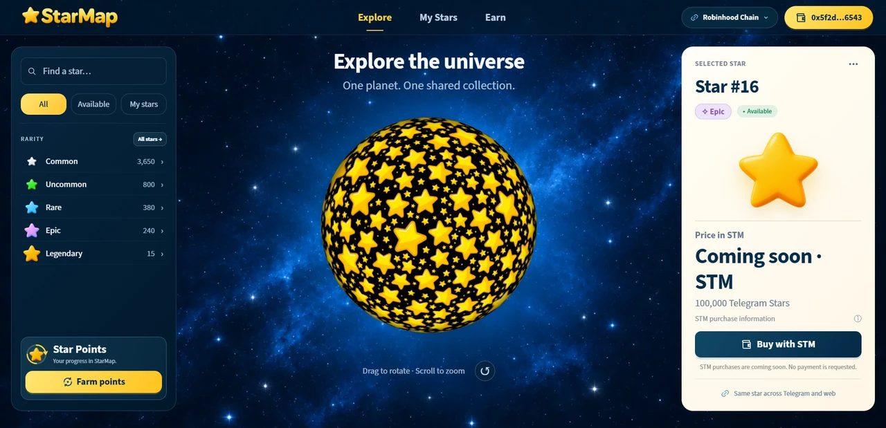

# StarMap - браузерная карта звёзд

**Коммерческий проект. Исходный код закрыт.**

Этот репозиторий содержит описание проекта и демонстрационные материалы. В портфолио кнопка «Код» показывает только структуру папок и имена файлов.

Автор проекта - **Евгений Толмачев**. [Профиль GitHub](https://github.com/EvgenyET) · [Проект в портфолио](https://evgeny-dev.pro/project.html?id=StarMap_web_app)

Браузерная 3D-карта StarMap с выбором звёзд, личным кабинетом и коллекцией. Подключение криптокошелька, фарминг, приглашения и отдельная мобильная компоновка.

## Задача проекта

Отдельное браузерное приложение экосистемы StarMap, использующее общие игровые правила и визуальную модель карты. Здесь требуются собственные сценарии учётной записи, кошелька и оформления покупки, а также согласование выбранной звезды с состоянием панелей и коллекции.

## Мой вклад

Адаптировал трёхмерную карту к браузерному интерфейсу и связал выбор звезды с панелью подробностей. Разработал кабинет, загрузку коллекции и сценарии кошелька, фарминга и приглашений. Подготовил мобильную компоновку и серверные модули расчёта покупки и хранения её состояния.

## Интерфейс

**Карта и панель выбранной звезды в браузере**

**Игровой кабинет на телефоне**

## Как работает приложение

Веб-версия StarMap позволяет исследовать звёздную карту в обычном браузере. Выбранная на сфере звезда открывается в панели с подробностями, откуда пользователь переходит к её покупке. Личный кабинет объединяет коллекцию, фарминг и приглашения, а подключение кошелька входит в сценарий работы с аккаунтом. На компьютере карта и панели располагаются рядом, на телефоне интерфейс адаптирован под сенсорное управление.

## Возможности

- Трёхмерная карта с вращением, масштабированием и выбором отдельных звёзд.
- Панель подробностей, связанная с выбранным объектом сцены.
- Личный кабинет с коллекцией и состоянием пользователя.
- Подключение кошелька и сценарий оформления покупки.
- Фарминг и реферальные приглашения из кабинета.
- Отдельная организация панелей для компьютера и сенсорного экрана.

## Техническое устройство

### Карта

Модуль карты связывает выбранный объект в трёхмерной сцене с панелью подробностей. На компьютере панель соседствует с картой, а для сенсорного экрана подготовлена отдельная компоновка.

### Кабинет

Кабинет объединяет учётную запись, состояние кошелька и коллекцию. Это позволяет вернуться от отдельной звезды к объектам, уже связанным с пользователем.

### Покупки

На сервере предварительный расчёт покупки отделён от её оформления и сохранения состояния. Панель карты и кошелёк участвуют в одном сценарии, но отвечают за разные его шаги.

## Технологии

| Технология | Роль в проекте |
| --- | --- |
| JavaScript | Интерактивная карта и интерфейс кабинета. |
| Node.js | Серверные операции и состояние покупок. |
| CSS | Адаптивные панели для телефона и рабочего стола. |

## Демонстрация

На странице портфолио доступны описание, галерея и видеодемонстрация проекта. [Открыть StarMap - браузерная карта звёзд](https://evgeny-dev.pro/project.html?id=StarMap_web_app).
