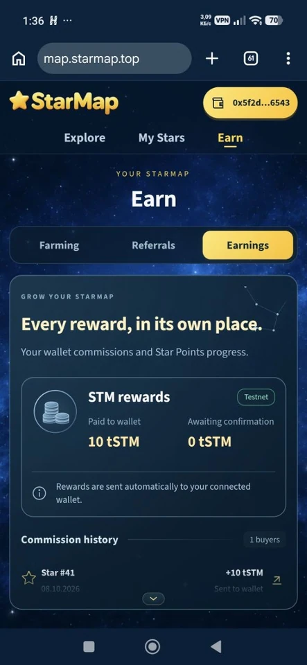

# StarMap - браузерная карта звёзд

**Автор проекта:** [Евгений Толмачев](https://github.com/EvgenyET) · [Страница проекта в портфолио](https://evgeny-dev.pro/project.html?id=StarMap_web_app)

Веб-приложение с интерактивной картой, личным кабинетом, коллекцией звёзд и подключением кошелька.

## Мой вклад

Адаптировал звёздную карту для запуска в обычном браузере. Связал выбор звезды с панелью подробностей, личным кабинетом и коллекцией. Подготовил сценарии подключения кошелька и отдельную мобильную компоновку.

## Интерфейс

**Карта и панель выбранной звезды в браузере**

**Игровой кабинет на телефоне**

## Как это работает

На карте можно выбрать звезду и рассмотреть её параметры. Личный кабинет объединяет коллекцию, фарминг и реферальную программу. Интерфейс адаптирован для мыши и сенсорного экрана.

## Возможности

- Карта с выбором звезды и панелью подробностей.
- Подключение кошелька, личный кабинет и коллекция.
- Фарминг, приглашения и оформление покупки.

## Технологии

- **JavaScript** - Интерактивная карта и интерфейс кабинета.
- **Node.js** - Серверные операции и состояние покупок.
- **CSS** - Адаптивные панели для телефона и рабочего стола.

## О проекте

Веб-версию можно открыть непосредственно в браузере. Она использует общие игровые правила StarMap, а сценарии входа, подключения кошелька и покупки спроектированы для браузера.

Коммерческий проект. Исходный код закрыт.
